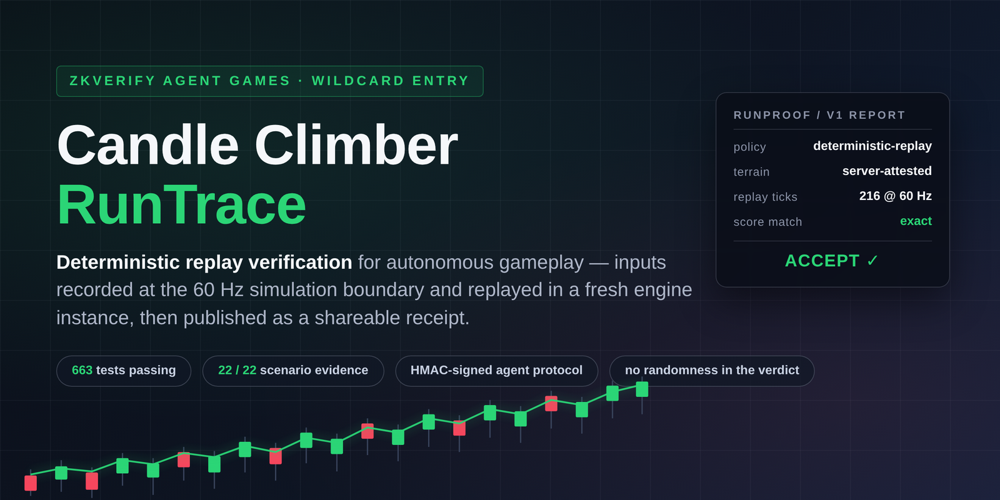
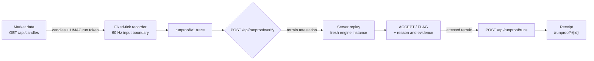
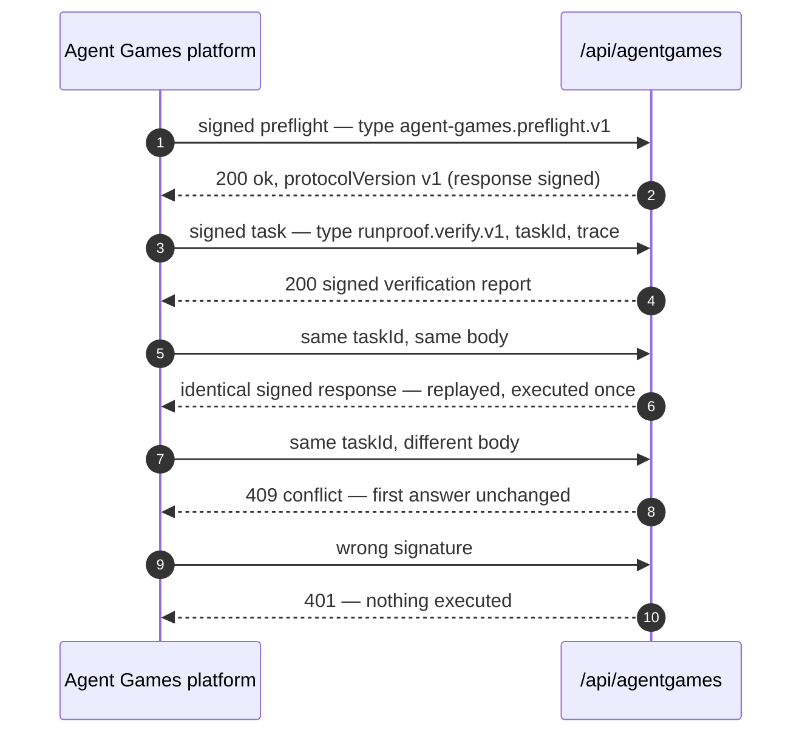

# Candle Climber — RunTrace

<p align="center">
  
</p>

**Deterministic replay verification and signed run receipts for the Candle Climber game engine — with an autonomous, rule-based QA agent that plays it.**

RunTrace records gameplay input at the fixed 60 Hz simulation boundary (not at browser frame time), replays it against the same engine, and turns a matching run into a shareable receipt. Player runs use the day's real market chart: `GET /api/candles` signs the level it served, and the verifier recomputes the candle fingerprint, so a receipt cannot be moved to hand-edited terrain. A deterministic, rule-based QA agent (`RivalBot`) plays the game on its own, so runs can also be produced and checked without a human in the loop.

This build is prepared as a **Wildcard entry for [zkVerify Agent Games](https://agentgames.zkverify.io/events/wildcard)**. Judging this repository? Start with the [judges' guide](docs/JUDGES-GUIDE.md) — it maps every claim to code, tests, and recorded evidence.

| | |
| --- | --- |
| Live demo | <https://candle-climber-runtrace.vercel.app> |
| Signed agent endpoint | `POST https://candle-climber-runtrace.vercel.app/api/agentgames` |
| Production evidence | [`docs/evidence/agent-games-scenarios.json`](docs/evidence/agent-games-scenarios.json) — 22/22 scenarios, recorded against the deployment (runproof-only evidence, recorded 2026-11-19; predates the experimental gatekeeper prover, commit 7f3706a) |
| Judges' guide | [`docs/JUDGES-GUIDE.md`](docs/JUDGES-GUIDE.md) — architecture, protocol, and the two-minute reproduction path |

> **Scope.** This is a deterministic replay-consistency check implemented in TypeScript, not a zero-knowledge proof, not anti-cheat, and not identity verification. It answers one narrow question: *given these inputs and this terrain, does this engine build reproduce the recorded outcome?* The bundled gatekeeper prover is an experimental module that proves gatekeeper decisions locally — never verified on zkVerify; no RunTrace claim is proven with it. See [Limits](#limits).

---

## Quick start

Requires [Bun](https://bun.sh) (the repository's pinned runtime).

```sh
bun install --frozen-lockfile
bun run dev          # http://localhost:3000
```

| Route | What it is |
| --- | --- |
| `/` | Landing page |
| `/play` | The game (Space / ↑ / W to jump, Shift for RUSH) |
| `/runproof` | RunTrace console: play the day's chart, replay-check it, save a receipt, run the QA suite |
| `/runproof/r/{id}` | A stored receipt, with a one-click re-verification |
| `/leaderboard`, `/stats`, `/partners`, `/airdrop`, `/ops` | Game economy and operator surfaces |
| `POST /api/runproof/verify` | Verify a trace (checks the run token when present) |
| `POST /api/runproof/runs` · `GET /api/runproof/runs/{id}` | Issue and read receipts (attested terrain required) |
| `POST /api/agentgames` | Signed Agent Games protocol: preflight, verification tasks, idempotency |

Run the whole surface end to end, including an automated player:

```sh
bun scripts/agent-games-scenarios.ts
```

It plays today's signed market level, sends the trace through the public
endpoints and the signed protocol, and writes
[`docs/evidence/agent-games-scenarios.json`](docs/evidence/agent-games-scenarios.json).

## How verification works

1. **Capture.** `FixedTickInputRecorder` stamps each jump / RUSH / world-transition action at the engine's fixed 60 Hz step boundary, together with the terrain the run used and the run token the server issued for it.
2. **Attest.** The server recomputes the terrain fingerprint from the trace's candles and checks it against the token's HMAC. Edited candles, a different symbol/date, or a forged token are flagged; a missing token is reported as unattested terrain.
3. **Replay.** The verifier rebuilds platforms and daily mutations from the submitted terrain and inputs, then steps the engine forward in a fresh instance.
4. **Compare.** Replayed score, jumps, landings, scoring events, and final totals are compared against the claims in the trace.
5. **Decide.** The endpoint returns `ACCEPT` or `FLAG` with a short reason, evidence, and replay diagnostics. A receipt stores that verdict plus the trace.



The verifier is deterministic TypeScript. No model, network call, or randomness is involved in the decision.

## Verification contract

`POST /api/runproof/verify` accepts a `runproof/v1` trace and returns:

- `task: "verify-run-trace"`
- `policy: "runproof/deterministic-replay/v1"`
- `decision: "ACCEPT" | "FLAG"`
- a short reason, evidence, and replay diagnostics

Malformed or out-of-bounds requests return an HTTP error rather than a decision. A well-formed trace that disagrees with replay gets `FLAG`.

- Input schema: [`docs/runproof/trace-schema.v1.json`](docs/runproof/trace-schema.v1.json)
- Result schema: [`docs/runproof/task-contract.v1.json`](docs/runproof/task-contract.v1.json)
- Product notes: [`docs/runproof/README.md`](docs/runproof/README.md)

**Request controls.** The handler prechecks `Content-Length` and enforces a streamed 2,000,000-byte cap, admits at most 2 concurrent requests per process, and limits each client key to 12 requests per rolling 60 seconds (key map capped at 2,048 entries). These controls are process-local and are not a substitute for ingress-level protection on a scaled deployment.

## Signed agent endpoint

`POST /api/agentgames` speaks a signed, idempotent protocol for the platform: request and response bodies are HMAC-signed over the exact raw bytes, the task ID doubles as an idempotency key, and the route stays inert (503) until a secret is configured — it never accepts unsigned tasks.



The digest profile (HMAC-SHA-256 over the raw body, UTF-8 key, lowercase hex) is documented as an implemented choice, not a confirmed platform contract — see [`docs/runproof/agentgames-protocol.md`](docs/runproof/agentgames-protocol.md).

## Autonomous QA agent

`RivalBot` is a deterministic planner: it chooses jump / RUSH actions from the seed, engine state, and one of three existing personality profiles — precise (`wickcop`), greedy (`goldenbull`), patient (`frostliquidator`). It uses no LLM, no network, and no randomness for gameplay decisions.

The `/runproof` suite runs six cases (two deterministic QA-fixture seeds × three profiles, up to 1,800 fixed ticks each). Optional observer hooks capture the bot's actual jump / RUSH / world-transition actions and the engine's own jump, landing, and score events. Those captured traces are then checked by the separate replay path above, and a bounded invariant layer verifies:

- finite core engine values
- legal jump / RUSH / world-transition sequences
- grounded player alignment with a live platform
- non-decreasing time, score, candle count, and best streak

Each finding carries the seed, profile, ruleset, a descriptive local build ID, the full trace, and replay evidence. The build ID is descriptive — it is not a source hash or a signed attestation.

## Limits

These constraints are deliberate and stated up front:

- **No cryptographic proof.** There is no zk proof, wallet signature, or zkVerify submission in this build's verification path. The bundled gatekeeper prover is an experimental module outside this path; its proofs are local-only and never verified on zkVerify.
- **Terrain is attested, inputs are not.** Player runs use the day's real market candles and the server-signed run token binds the terrain; the input log itself is caller-supplied and its origin is not authenticated. The QA suite uses a deterministic fixture terrain on purpose.
- **No identity claim.** A result never identifies or proves that a human played, and no receipt binds a run to a wallet.
- **Same-engine replay.** The bot run and its replay use the same engine. The invariants are bounded sanity checks, not an independently implemented physics oracle.
- **Bounded meaning of PASS.** A pass means these traces matched and these listed invariants held for the tested cases — not that all game physics is correct.

The verifier's full honesty boundary is documented in [`docs/runproof/README.md`](docs/runproof/README.md).

## Repository layout

```
src/game/cc/            Game engine, physics, rendering, scoring
src/game/cc/rival/      Deterministic RivalBot planner
src/game/runproof/      Recorder, replay verifier, QA agent, HTTP guard
src/game/agentgames/    Composable adapter factory (signature/preflight/idempotency)
src/app/runproof/       RunTrace console and receipt pages
src/app/api/runproof/   Verification and receipt endpoints
docs/runproof/          Trace schema, result contract, product notes
docs/competition/       Agent Games submission material
```

## Competition material

- [Judges' guide — start here](docs/JUDGES-GUIDE.md)
- [Submission overview](docs/competition/README.md)
- [Submission TODO — the checklist](docs/competition/TODO.md)
- [Wildcard entry draft](docs/competition/wildcard-entry.md)
- [Creator Track content plan](docs/competition/creator-track.md)
- [Agent Games protocol notes](docs/runproof/agentgames-protocol.md)
- [Scenario evidence](docs/evidence/agent-games-scenarios.json)
- [Product identity — this build vs. the original game](docs/PRODUCT-IDENTITY.md)
- [Visual direction (proposal)](docs/design/visual-direction.md)
- [Deployment guide](docs/DEPLOYMENT.md)

## Checks

```sh
bun run lint
bun test
bunx tsc --noEmit --incremental false
node node_modules/next/dist/bin/next build   # production build; see docs/DEPLOYMENT.md for why this runs under Node
```

## License

See [LICENSE](LICENSE).
