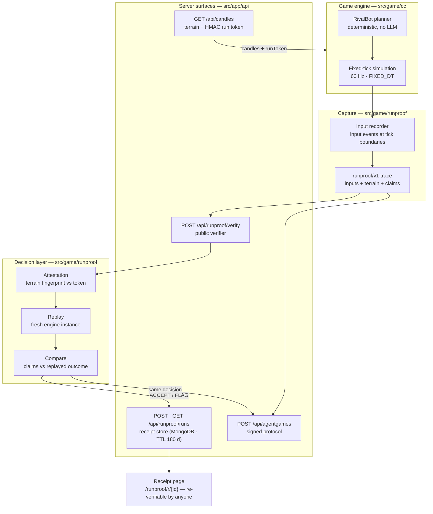
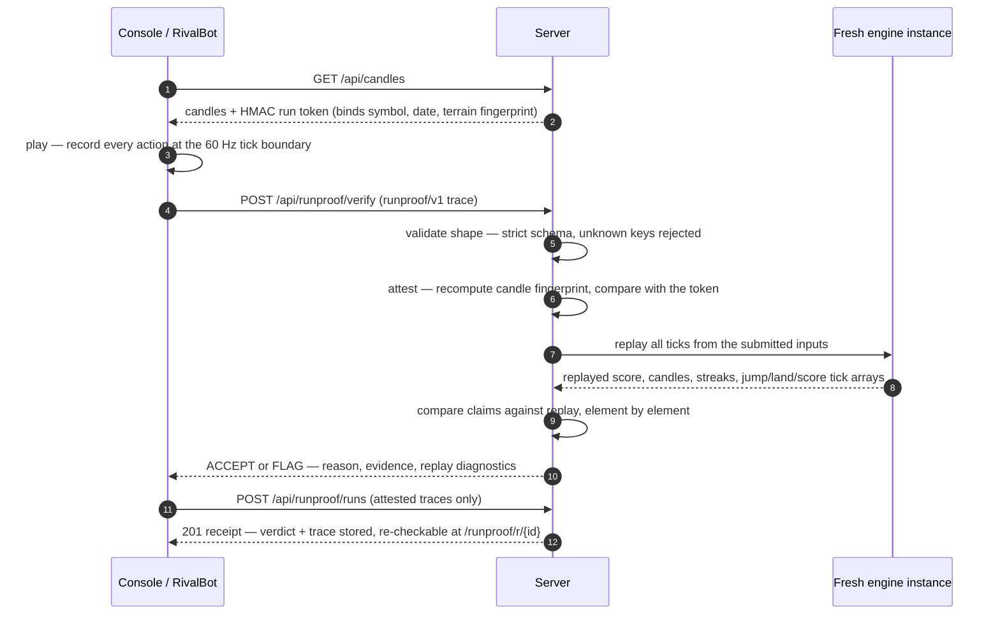
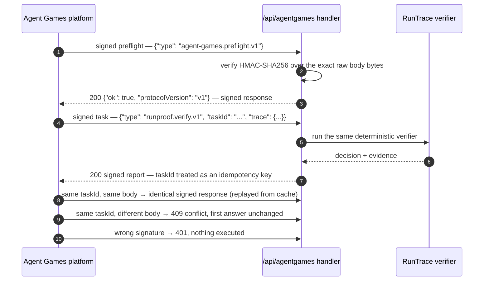

# Judges' guide — Candle Climber · RunTrace

**Audience:** Agent Games judges and technical reviewers evaluating this repository as a
Wildcard entry for [zkVerify Agent Games](https://agentgames.zkverify.io/events/wildcard).

**The one-sentence version:** RunTrace records gameplay inputs at the fixed 60 Hz
simulation boundary, replays them in a fresh instance of the same engine, compares the
replayed outcome against the recorded claims, and publishes the verdict as a shareable,
re-verifiable receipt — with the terrain bound to the run by a server-signed token.

| | |
| --- | --- |
| Live demo | <https://candle-climber-runtrace.vercel.app> |
| Public console | [/runproof](https://candle-climber-runtrace.vercel.app/runproof) — play, verify, save a receipt |
| Signed endpoint | `POST /api/agentgames` — preflight, verification tasks, idempotency |
| Machine-readable evidence | [`docs/evidence/agent-games-scenarios.json`](evidence/agent-games-scenarios.json) — 22/22 scenarios against the deployment |
| Submission checklist | [`docs/competition/TODO.md`](competition/TODO.md) |

---

## 1. Verify everything yourself in under two minutes

The whole surface — including an automated player that genuinely plays the day's level —
is reproducible with one command after a normal clone and install:

```sh
git clone https://github.com/0o0r7/candle-climber-runtrace-agentgames
cd candle-climber-runtrace-agentgames
bun install --frozen-lockfile
bun test                          # 663 tests, 62 files
bun scripts/agent-games-scenarios.ts   # 22 scenarios, writes machine-readable evidence
```

The scenario suite covers the public pages, the attested terrain, a genuine headless
agent run, the public verifier (`ACCEPT` and every documented `FLAG` reason), receipts,
the signed protocol, and the transport guards. Without `AGENT_GAMES_HMAC_SECRET` set
locally, the four signed-protocol scenarios are reported `SKIP` and everything else
still runs; against the production deployment the signed scenarios need the platform's
key. The committed evidence file holds the production run.

Spot-check the live deployment without cloning:

```sh
curl -s -o /dev/null -w "%{http_code}\n" https://candle-climber-runtrace.vercel.app/runproof        # 200
curl -s -X POST https://candle-climber-runtrace.vercel.app/api/agentgames \
     -H "content-type: application/json" -d '{}'                                                   # 401 — signature gate
curl -s -X POST https://candle-climber-runtrace.vercel.app/api/runproof/verify \
     -H "content-type: application/json" -d '{}'                                                   # 200 — FLAG: Expected runproof/v1.
```

## 2. System architecture

The verification layer sits on top of the existing Candle Climber engine and does not
modify gameplay. Each concern — capture, attestation, replay, storage, protocol — is an
independent module behind its own boundary.



## 3. The public verification path



A trace that disagrees with its own replay is flagged with a specific issue code —
`score_mismatch`, `ticks_after_death`, `run_token_terrain_mismatch`,
`mutation_mismatch`, `run_token_seed_mismatch` — so a forged score is not merely
rejected but *diagnosed*. The negative-path matrix in
[`docs/competition/READINESS.md`](competition/READINESS.md) lists one case for every
claim; each `FLAG` case asserts its own code, so a flag for the wrong reason still
counts as a failure.

## 4. The signed Agent Games protocol

`POST /api/agentgames` is the opt-in surface for the platform. It stays inert (503)
until `AGENT_GAMES_HMAC_SECRET` is configured — it never accepts unsigned tasks.



**Signature profile — stated honestly.** The published pages describe signing raw
bytes but do not name the algorithm or header encoding. This build implements one
documented candidate — HMAC-SHA-256 over the exact raw body, UTF-8 key from the
displayed secret string, lowercase hex — and labels it as an inference from competitor
implementations, not a confirmed platform contract
([`docs/runproof/agentgames-protocol.md`](runproof/agentgames-protocol.md)). If the
platform sends signed tasks with a different profile, only the injected
`AgentGamesSignatureProvider` needs replacing; the verifier is untouched.

**Both paths answer with the same decision.** A signed task and a public
`POST /api/runproof/verify` call map to the same verifier, so the platform is never the
only way in — judges can reproduce any verdict through the public route alone.

## 5. What the tests cover

- `bun test` — 663 tests across 62 files: engine invariants, recorder/replay
  compatibility, signature gates, store fallbacks, pre-launch guards.
- `bun scripts/agent-games-scenarios.ts` — 22 end-to-end scenarios against a running
  server: pages, terrain attestation, a genuine headless agent run, `ACCEPT`, every
  documented `FLAG` code, receipts, the signed protocol, and the 413 / 400 / 422
  transport guards.
- CI runs lint, tests, and `tsc --noEmit` on every push to the tracked branches.

## 6. Stated limits — read before scoring

These constraints are deliberate and are documented where the code lives
([`docs/runproof/README.md`](runproof/README.md)):

- **No cryptographic proof.** No zk proof, no wallet signature, no zkVerify submission
  in this build's verification path. zkVerify integration is documented as a v2
  direction, and agents without zkVerify are eligible per the Wildcard page.
- **Terrain is attested; inputs are not.** The server-signed run token binds the trace
  to the terrain the server actually served; the input log itself is caller-supplied
  and its origin is not authenticated.
- **No identity claim.** A verdict never identifies who played; receipts do not bind
  runs to wallets.
- **Same-engine replay.** Replay uses the same engine build — it checks
  replay-consistency, not independent physics correctness.

## 7. Where to look in the code

| Area | Path |
| --- | --- |
| Verifier core (replay + compare) | `src/game/runproof/verify.ts` |
| Terrain attestation (run token) | `src/game/runproof/attest.ts` |
| Input recorder | `src/game/runproof/recorder.ts` |
| Headless agent runner | `src/game/runproof/agent-run.ts` |
| Signed protocol adapter | `src/game/agentgames/adapter.ts` |
| Task envelope mapping | `src/game/agentgames/tasks.ts` |
| HTTP guard (2 MB cap, rate, concurrency) | `src/game/runproof/http-guard.ts` |
| Receipt store (MongoDB + memory fallback) | `src/lib/runproof-store.ts` |
| Endpoint wiring | `src/app/api/runproof/verify/route.ts`, `src/app/api/agentgames/route.ts` |
| Deterministic bot | `src/game/cc/rival/bot.ts` |
